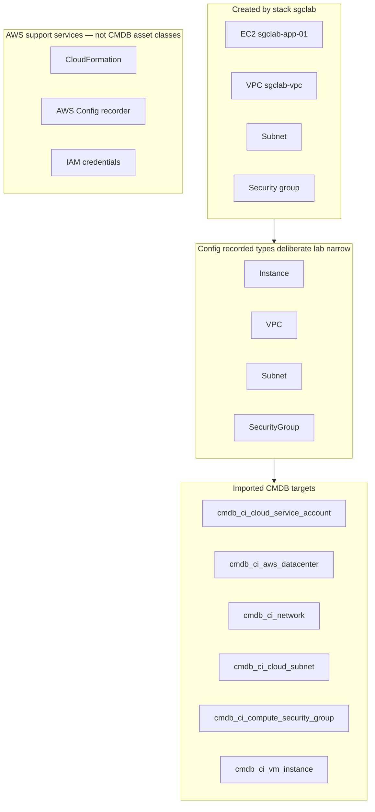
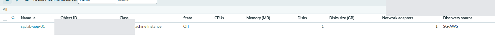
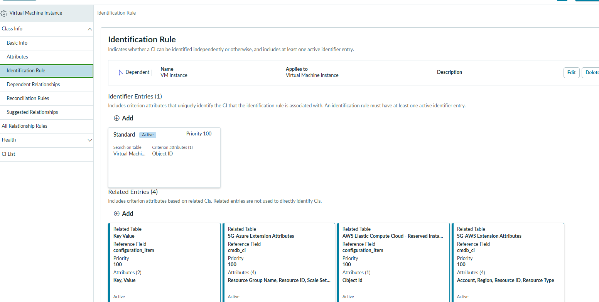
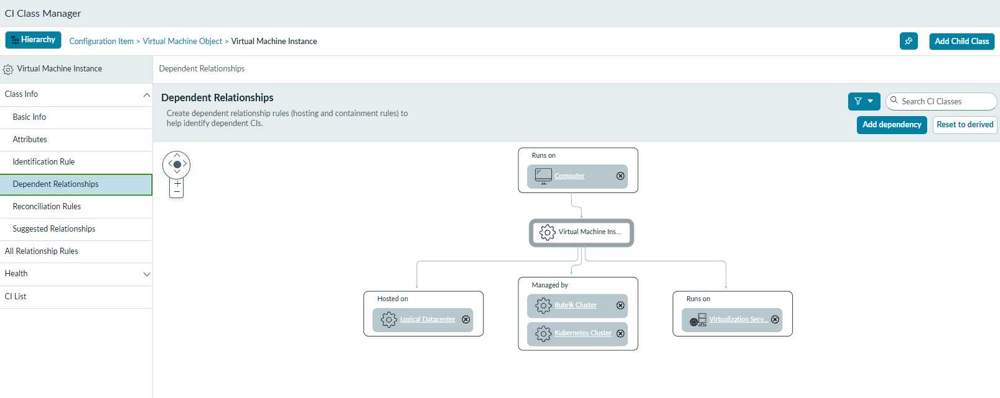
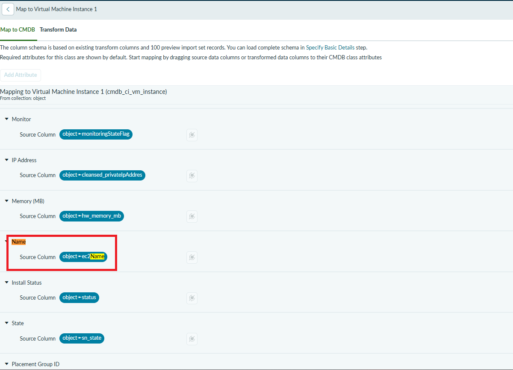
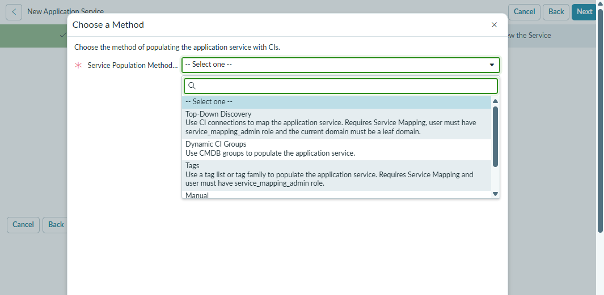
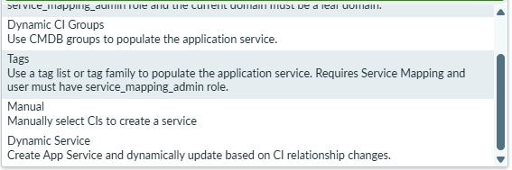
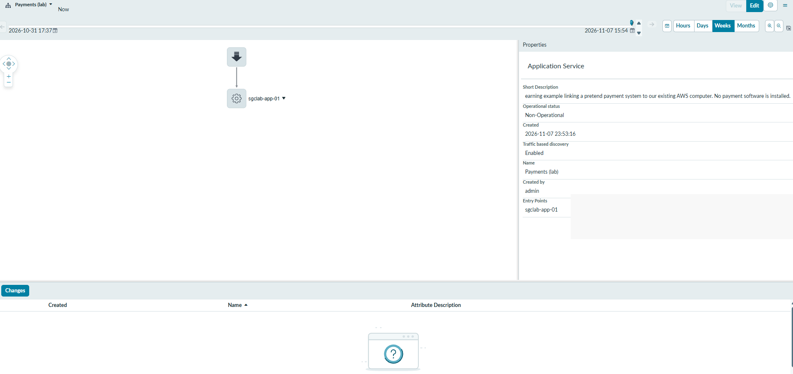

ServiceNow PDI

# ServiceNow_ServiceGraph_Demo

> [!WARNING]
> This is an attempt to be no cost, but it may instead be low cost. See AWS/Azure, follow the balance warnings, etc.

Following this Lab I generated with AI, specifically to teach the Service Graph Connector, and get something working for individuals who don't have SCCM / Windows Server. So if you have a typical Windows 11 Machine or maybe Linux...

**Full lab (authoritative detail):** [ServiceNow Service Graph Lab](https://eltonaguiar.github.io/ServiceNow_ServiceGraph_Lab/) — start at [prerequisites](https://eltonaguiar.github.io/ServiceNow_ServiceGraph_Lab/labs/00-prerequisites/).

Below is a **light PoC walkthrough** from running that lab on a PDI; it is **not** the full curriculum and does **not** mean every page on the [full lab site](https://eltonaguiar.github.io/ServiceNow_ServiceGraph_Lab/) has been rewritten. Use the lab site for authoritative depth; use **this** repo for what we actually clicked on a disposable PDI (including deviations).

As shown in [Lab 7](https://eltonaguiar.github.io/ServiceNow_ServiceGraph_Lab/labs/07-csdm-graph/), these notes aim to make the walkthrough more beginner-friendly by explaining acronyms and technical terms as they appear. This demo follows a shorter path, so some steps from the full lab are skipped; deviations and unfinished steps are noted below.

## Demo scope and actual progress

| Through | Status | Authoritative lab page |
|--------|--------|-------------------------|
| Labs 0–4 | Walkthrough + screenshots in this file | [Lab 4 — Run import](https://eltonaguiar.github.io/ServiceNow_ServiceGraph_Lab/labs/04-run-import/) |
| Lab 5 | **Completed** — IRE look-only steps below | [Lab 5 — IRE](https://eltonaguiar.github.io/ServiceNow_ServiceGraph_Lab/labs/05-ire/) |
| Lab 6 | **Completed** — hands-on mapping below (**deviates** from published read-only Part A) | [Lab 6 — ETL](https://eltonaguiar.github.io/ServiceNow_ServiceGraph_Lab/labs/06-etl-mappings/) · [demo deviations](docs/LAB-DEVIATIONS.md) |
| Lab 7 | **In progress** — manual **View Map** checkpoint done; **Business Application** / offering layer **not done** | [Lab 7 — CSDM](https://eltonaguiar.github.io/ServiceNow_ServiceGraph_Lab/labs/07-csdm-graph/) |
| Lab 8 | **Optional — skipped** (Azure) | [Lab 8](https://eltonaguiar.github.io/ServiceNow_ServiceGraph_Lab/labs/08-multisource-azure/) |
| Labs 9–11 | **Not started** (Lab 9 not the immediate next step) | [Lab 9](https://eltonaguiar.github.io/ServiceNow_ServiceGraph_Lab/labs/09-drift-monitoring/) |

**Screenshot inventory:** [docs/SCREENSHOT-INVENTORY.md](docs/SCREENSHOT-INVENTORY.md) (included vs missing for this publish).

Verified lab region example: **US East (Ohio) `us-east-2`**. One **stopped** rented computer named **`sgclab-app-01`** (`t3.micro`).

---

## Words first (then the jargon)

| Everyday idea | Technical term | In this demo |
|---------------|----------------|--------------|
| A **rented cloud computer** you can stop and start like a hotel room | **EC2 instance** | `sgclab-app-01` |
| Your **private neighborhood network** inside the cloud account | **VPC** | `sgclab-vpc` `10.42.0.0/16` (+ AWS **default** VPC still exists) |
| A **slice of that neighborhood’s street addresses** | **Subnet** | `sgclab-subnet` — name does not mean “public” or “private” by itself |
| **Stateful traffic rules** stuck to network interfaces (not a classic subnet firewall box) | **Security group** | `sgclab-sg`, no inbound rules in template |
| A **city-sized datacenter campus** | **AWS Region** | `us-east-2` |
| One **building zone** inside that campus | **Availability Zone** | Subnet uses first AZ in stack template |
| **Disk space** attached to the computer | **EBS volume** | Exists for instance; **not** in lab Config’s four recorded types → import partials common |
| **Change log / inventory snapshots** AWS keeps of resource shapes | **AWS Config** | Recorder on; types: Instance, VPC, Subnet, SecurityGroup only |
| **Login identity** for APIs (not something you put in the CMDB as “the server”) | **IAM** user/role | Supports connector; **not** the same as inventory CIs |
| ServiceNow’s **inventory database** | **CMDB** | Tables below |
| **One row** in that database | **CI** (configuration item) | e.g. one VM row |
| **Table** | e.g. `cmdb_ci_vm_instance` | Filter Navigator: `cmdb_ci_vm_instance.list` |
| Engine that **matches new rows to old** | **IRE** | Read outcomes in Lab 5; warnings in Lab 6 |
| **Recipe** from AWS JSON → CMDB columns | **ETL** (IntegrationHub ETL) | Lab 6 |
| Something people **rely on** (lab tag only here) | **Application service** (CSDM) | Lab 7 **in progress** — manual map done; business-app layer pending |

**Not the same thing:** A **cloud VM row** (`cmdb_ci_vm_instance`) is **not** a **Windows Server** CI (`cmdb_ci_win_server`). OS class needs guest discovery; **stopped** instance → **no OS inventory**.

---

## What exists vs what gets imported

Source of truth template: [`aws/lab-stack.yaml`](https://github.com/eltonaguiar/ServiceNow_ServiceGraph_Lab/blob/main/aws/lab-stack.yaml) (counts below from template; default VPC is **not** created by template).

| Layer | What you have | Lab count (template) | Notes |
|-------|----------------|----------------------|--------|
| **AWS resources** | VPC, subnet, SG, EC2 | 1 each from stack | Plus account **default VPC** in console (not from template) |

**Exact resources from stack `sgclab`** ([template](https://github.com/eltonaguiar/ServiceNow_ServiceGraph_Lab/blob/main/aws/lab-stack.yaml)): `sgclab-vpc` (`10.42.0.0/16`), `sgclab-subnet` (`10.42.1.0/24`, first AZ in region), `sgclab-sg` (no inbound rules), `sgclab-app-01` (`t3.micro`, Amazon Linux 2023 AMI via SSM parameter). Tags include **Environment** `lab`, **Application** `payments`, **Owner** (parameter).

| **Config recordings** | Four resource types only | 0 rows for **NetworkInterface** / **Volume** in walkthrough | Optional job `SG-AWS-NetworkInterface` skipped |
| **CMDB CIs** | After imports 100→180 | 1 VM, 2 VPC **network** rows typical | Depends on IRE; partial NIC/volume relations possible |

**Infrastructure in AWS ≠ successfully imported graph.** Job **Processed** only means the pipeline touched a row — open **lists and IRE warnings**.

---

## Breadcrumbs (release-dependent — verify on your PDI)

### AWS console (Ohio example)

| Goal | Where to click |
|------|----------------|
| Stacks | Search → **CloudFormation** → **Stacks** (`sgclab`, `sg-aws-config`, …) |
| Stopped computer | **EC2** → **Instances** → `sgclab-app-01` |
| Networks | **VPC** → **Your VPCs** / **Subnets** / **Security groups** |
| Config recorder | Search → **AWS Config** → **Settings** |
| Region | Top bar **US East (Ohio) us-east-2** |

### ServiceNow

| Goal | Filter Navigator (`.list` URL) | UI label (may vary) |
|------|-------------------------------|---------------------|
| Cloud VM | `cmdb_ci_vm_instance.list` | **Virtual Machine Instance** |
| VPC as network | `cmdb_ci_network.list` | **Cloud Networks** |
| Subnet | `cmdb_ci_cloud_subnet.list` | **Cloud Subnet** |
| Security group | `cmdb_ci_compute_security_group.list` | **Compute Security Group** |
| Region datacenter | `cmdb_ci_aws_datacenter.list` | **AWS Datacenter** |
| Account | `cmdb_ci_cloud_service_account.list` | **Cloud Service Account** |
| Schedules | Service Graph Connector for AWS → **Scheduled Imports** | exact menu path varies by release |
| ETL map | **IntegrationHub ETL** → **Configuration** | definition `SG-AWS-EC2-Instance` |
| Application service (Lab 7) | `cmdb_ci_service_auto.list` | **Service Instances** |

### Import schedule → CMDB table (standalone orders used on this PDI)

| Order | Schedule | AWS inventory item | CMDB table |
|------:|----------|-------------------|------------|
| 100 | `SG-AWS-Service-Account` | Cloud account | `cmdb_ci_cloud_service_account` |
| 110 | `SG-AWS-Datacenters` | Region / AZ campus | `cmdb_ci_aws_datacenter` |
| 120 | `SG-AWS-VPC` | VPC (private network) | `cmdb_ci_network` |
| 130 | `SG-AWS-Subnets` | Subnet | `cmdb_ci_cloud_subnet` |
| 140 | `SG-AWS-NetworkInterface` | *(optional — 0 Config rows in this lab)* | — |
| 150 | `SG-AWS-Security-Group` | Security group | `cmdb_ci_compute_security_group` |
| 180 | `SG-AWS-EC2` | Rented computer (EC2) | `cmdb_ci_vm_instance` |

Schedule labels on your instance may append a numeric suffix (e.g. `…100`); match by name stem.

---

## AWS Free plan note (this walkthrough account)

Newer accounts may show a **Free plan** with **credits** and a **~six-month** window (see your Billing home — not the same as legacy 12-month free tier for everyone). **Conserving credits** still matters: **Config**, **S3 delivery**, **EBS**, and **public IPv4** can charge while a instance is **stopped**. Upgrading to **paid** is a separate decision with its own billing rules — do not generalize from one account screenshot to all accounts.

---

## PDI

**Full lab instructions (Lab 0):** [Lab 0 — Prerequisites](https://eltonaguiar.github.io/ServiceNow_ServiceGraph_Lab/labs/00-prerequisites/)

Get your PDI at [developer.servicenow.com](https://developer.servicenow.com).

Install these, to avoid delays, it will take some time to install!

To Install, for PDI, you can try to search for "Service Graph" under https://developer.servicenow.com/dev.do#!/manage-instance
otherwise, in your instance itself 

All Available Applications

under search, find and then press Install. Most important one for the main lab is Service Graph Connector For AWS. However, for another lab Service Graph Connector For Azure is nice to have(Lab 8, if you choose to)

---

## Setup your AWS Account

**Full lab instructions (Lab 0):** [Lab 0 — Prerequisites](https://eltonaguiar.github.io/ServiceNow_ServiceGraph_Lab/labs/00-prerequisites/) (account, budget, region — before [Lab 1](https://eltonaguiar.github.io/ServiceNow_ServiceGraph_Lab/labs/01-aws-inventory/))

> [!WARNING]
> Credit Card Required. Be careful, and stop the instance on the same day.

### Free AWS account (Amazon Web Services)
so starting here:
https://aws.amazon.com/pricing/

1. Create the account at [aws.amazon.com/free](https://aws.amazon.com/free). A card is required for identity verification.
2. **Immediately** set a budget alarm. The **Settings → Billing** page (credits and days remaining) does **not** have budgets. Open the **Billing and Cost Management** console instead:
   - Direct link: [https://us-east-1.console.aws.amazon.com/cost-management](https://us-east-1.console.aws.amazon.com/cost-management) (or search for **Budgets** in the top search bar).
   - You will see something like this when you click your profile on the top right
   - 
  
   - Alternative way:  go to Billing & Cost Management
   - Choose **Budgets** → **Create budget** → **Use a template (simplified)**.
   - Pick **Zero spend budget** or a **Monthly cost budget** of **$1–5** with an alert at 50%.
  
I put a zero spend budget:

   - Enter your email, create the budget, and **verify the email** so alerts actually send.

Email verify confirmation method (confirmation email landed in my spam folder initially)
Find email like this:

Click the Verify link:
   - 

4. Choose one region and stick to it for the whole lab (for example `us-east-2` (Ohio — verified in this walkthrough) or your own single region). Multi-region imports multiply the data and the surprises.
5. Note your **12-digit account ID** (top-right account menu).

top right menu-->My Account-->AWS Management Console-->Search-->CloudFormation , it will go into your Recently Visited after

-->

   https://us-east-2.console.aws.amazon.com/cloudformation/home?region=us-east-2
(or replace us-east-2 with whatever region you chose in Lab 0).

### What “free tier” actually means in 2026

Accounts created after mid-2025 are on a **credit-based Free plan**, not the old twelve-month allowance.

> [!IMPORTANT]
> **You start with a credit balance.** The plan ends when the credits run out or after about six months, whichever comes first. After that, resources are stopped or billed depending on the choice you made at signup.
>
> A public **IPv4 address is billed per hour** on most account types. Networking is where the surprise charges come from, not the instance.
>
> `t3.micro` / `t2.micro` is only “free” inside a monthly hour allowance and only in a new account. An instance left running past the allowance bills normally.

<strong>How much does it actually cost? (AWS vs Azure)</strong>

### Approximate rates (late 2026, cheap US region)

| Item | AWS (t3.micro) | Azure (B1s) |
|------|----------------|-------------|
| VM compute | ~$0.0104/hour | ~$0.0104/hour |
| Public IPv4 | $0.005/hour (even if stopped) | ~$0.004–0.005/hour |
| Small disk | a few cents | a few cents |
| New-account free tier | $100–$200 credits (6 months) | $200 credit (30 days) + 750 free B1s hours/month for 12 months |

### Example costs for one lab VM

| Duration | Running | Stopped / deallocated (IP + disk kept) |
|----------|---------|----------------------------------------|
| **8 hours** | ~$0.12 | ~$0.04 |
| **2 days** | ~$0.75–$1.00 | ~$0.25–$0.40 |
| **1 month** | ~$11–12 | ~$4 |

**Notes**
- On AWS, a public IPv4 keeps charging after you stop the instance.
- On Azure, you must **deallocate** the VM (not just shut down inside the OS) to stop compute charges. Static IPs and managed disks still cost money.
- These amounts are usually covered by free-tier credits on a new account. The risk is forgetting resources for weeks.

**Rule for this lab:**

> Create → verify → stop the instance → delete the stack the same day.  
> Treat “I will clean up later” as the failure mode. Lab 11 is designed to take four minutes, not to be a chore you postpone.

The budget alarm is your only early warning, which is why it is step 2 and not an afterthought.

---

## Optional — Setup your Free Azure Account (Lab 8, if you choose to)

**Full lab instructions (Lab 8):** [Lab 8 — Multisource CMDB with Azure](https://eltonaguiar.github.io/ServiceNow_ServiceGraph_Lab/labs/08-multisource-azure/)

*(Lab 8 only)*

1. Create the account at [azure.microsoft.com/free](https://azure.microsoft.com/free).
2. Set a **Cost alert** in Cost Management → Budgets ($1–5).
3. Do **not** upgrade to pay-as-you-go for this lab.

You can complete Labs 0–7 and 9–11 without Azure.

# LAB 1 

**Full lab instructions:** [Lab 1 — Build a real AWS inventory](https://eltonaguiar.github.io/ServiceNow_ServiceGraph_Lab/labs/01-aws-inventory/)

Get the Template YAML lab-stack.yaml https://github.com/eltonaguiar/ServiceNow_ServiceGraph_Lab/blob/main/aws/lab-stack.yaml , then upload it under the Create Stack page

proceed to next step 
Step 2:

Stack name: enter sgclab.
ApplicationTag: leave payments.
InstanceType: leave t3.micro.
LabOwner: replace labuser with a label such as elton.
LatestAmazonLinuxAmi: leave the existing value unchanged.
Click Next, leave the stack options at their defaults, then Next → Review and create → Submit. Wait for CREATE_COMPLETE.

Afterward, open EC2 → Instances in the same region and stop—not terminate—the lab instance. It remains discoverable while stopped. Running compute can incur charges, and storage may still cost money while stopped.

Once done , note the CREATE_COMPLETE in the left section called Stacks

Before moving to Lab 2, also record the instance ID, VPC ID and region for the later inventory checks.

So the region would be found in the URL , and the rest under resources

Under Resources, copy the Physical ID beside LabInstance (i-…) and LabVpc (vpc-…). My region is us-east-2 (Ohio) , as per the URL.
Click the LabInstance Physical ID to open EC2, then select Instance state → Stop instance.

Stop the Instance 

Stopping it avoids running compute charges while you’re not using it. For this inventory lab, the connector can still discover a stopped instance and its tags; you don’t need the operating system running. Stop, don’t terminate—storage can still incur charges.

So per Lab 1 you should have these documents:

For Region its also in the URL

Account name could be acquired by going to Profile under the top right User profile menu

# Lab 2 , verify apps, installed

**Full lab instructions:** [Lab 2 — Install the connector](https://eltonaguiar.github.io/ServiceNow_ServiceGraph_Lab/labs/02-sgc-install/)

If not installed, then Install 
Service Graph Connector for AWS.

Navigate  to sys_store_app_list.do (you can type under filter navigator to get there)
Filter Navigator → `sys_store_app_list.do` (search applications for AWS connector)

ServiceNow 
Service Graph Connector for AWS --> sn_aws_integ

All dependencies, should have been installed with it e.g. 

Confirm IntegrationHub
Filter Navigator → Process Automation → Flow Designer. If it opens, IntegrationHub is active.
If Flow Designer is missing, the cloud REST flow cannot run — go to the fallback path.

AWS-Setup>

Get Started

# Lab 3 

**Full lab instructions:** [Lab 3 — Read-only IAM and the connection](https://eltonaguiar.github.io/ServiceNow_ServiceGraph_Lab/labs/03-iam-connection/)

to get there if in Console you can use the top menu Search and type IAM, then follow the link

Get to IAM

follow lab instructions:

Next step --> Permission-->Create Policy-->JSON.. 

paste the contents of https://github.com/eltonaguiar/ServiceNow_ServiceGraph_Lab/blob/main/aws/iam-readonly-lab-policy.json

Enter these details:

Policy name: ServiceNowSGCLabReadOnly (a suggested name for this lab).
Description: Read-only AWS inventory permissions for the ServiceNow Service Graph lab.
Tags: optional—leave empty.
Click Create policy. Then return to the user-creation tab, refresh the policy list, search for ServiceNowSGCLabReadOnly, select it, and continue creating servicenow-sgc-lab without console access.

Creating the policy doesn't attach it automatically.

On the other tab , I pressed Previous-->then next, then refresh and pasted in the policy name I created (ServiceNowSGCLabReadOnly)

Thus, attaching the policy to the user (you need to check the checkbox beside the Policy, see this screenshot)

The correct policy is selected. Leave Set permissions boundary unchanged, then:

Click Next.
Confirm the username is servicenow-sgc-lab and the attached policy is ServiceNowSGCLabReadOnly.
Click Create user.
Open the new user → Security credentials → Create access key.
Choose Application running outside AWS, then follow the prompts.
Keep the secret access key private—don’t include it in screenshots or chat.

User Created Successfully

next Open the new user → Security credentials → Create access key.
Choose Application running outside AWS, then follow the prompts.
Keep the secret access key private—don’t include it in screenshots or chat.

Create Access Key

Create a Stack, following these steps:
Here's the exact run, in order. You're doing three of the seven instruction groups; the rest get marked off as skipped.

In ServiceNow — Guided Setup

Download the scripts task → Configure → download the CloudFormation zip to your machine → Close → mark the task complete. Unzip it and find EnableAWSConfig.yml — that's the only file you need for now.
In the AWS Console (your lab account, your one region)

CloudFormation → Create stack → With new resources → Upload a template file → choose EnableAWSConfig.yml.
Stack name: sg-aws-config. Leave parameters at defaults unless one is clearly required (the template creates its own S3 bucket for Config delivery). If it asks you to acknowledge IAM resource creation, tick it — the stack creates the role AWS Config uses to record and deliver.
Submit and wait for CREATE_COMPLETE (a few minutes).
Sanity check: AWS Config → Dashboard/Settings — the recorder should show as On. That recorder is the connector's data source; without it, imports return nothing.
Back in ServiceNow — Guided Setup

AWS Setup Instructions task → open it, confirm the recorder group is the one you've done, and mark it complete. Aggregator, SSM, SendCommand, key rotation, and email notification are the skippable groups — single account, no deep discovery, lab account.
Move to the connection/configuration section of guided setup and confirm it points at what you built in Lab 3: your 12-digit account ID, the one region, and the credential record for servicenow-sgc-lab. Leave the aggregator field blank and skip any SSM/deep-discovery role step — both are the optional paths.
Run the Diagnostic Tool at the end of guided setup. Fix only what it flags.
If **Test connection / Validate** is offered, use it when it applies; in **standalone** mode it may report *unsupported* — expected, not a setup failure. Finish guided setup for your release (credentials, region, standalone account ID, Config recorder). A passing connection test alone does not prove imports will work. Leave scheduled import jobs alone until Lab 4.

**IAM, Config, and cost:** The screenshots above are a shortened path. Use [Lab 3 — IAM and connection](https://eltonaguiar.github.io/ServiceNow_ServiceGraph_Lab/labs/03-iam-connection/) for identity/Config prerequisites and test-result meanings, [prerequisites](https://eltonaguiar.github.io/ServiceNow_ServiceGraph_Lab/labs/00-prerequisites/) for cost notes, and [Lab 11 — cleanup](https://eltonaguiar.github.io/ServiceNow_ServiceGraph_Lab/labs/11-cleanup/) to tear down. AWS Config and its S3 delivery can bill; a **stopped** lab EC2 still retains disk (and often a public IPv4), so charges may continue until you delete the stacks and empty retained buckets.

so 2 stacks, the first one from earlier and this one

a few tweaks. update stack
make direct update

Your console shows an extra menu I missed. With sg-aws-config selected:

In the open Update stack menu, click Make a direct update.
On the next page, choose Use existing template, then Next.
You should reach Specify stack details, where the parameters appear.

# Lab 4 — Standalone AWS imports (verified minimum)

**Full lab instructions:** [Lab 4 — Run the import](https://eltonaguiar.github.io/ServiceNow_ServiceGraph_Lab/labs/04-run-import/)

Run **one** scheduled job at a time; wait until status is **Processed** (Loaded or Pending is not done).

| Order | Job (name may include numeric suffix on your instance) |
|------:|-----|
| 1 | `SG-AWS-Service-Account100` / `SG-AWS-Service-Account` |
| 2 | `SG-AWS-Datacenters110` / `SG-AWS-Datacenters` |
| 3 | `SG-AWS-VPC120` / `SG-AWS-VPC` |
| 4 | `SG-AWS-Subnets130` / `SG-AWS-Subnets` |
| 5 | `SG-AWS-Security-Group150` / `SG-AWS-Security-Group` |
| 6 | `SG-AWS-EC2180` / `SG-AWS-EC2` |

- Keep parent **`SG-AWS-Organization`** inactive — cascades dozens of jobs (SSM, EKS, …).
- **`SG-AWS-NetworkInterface`** optional — lab Config records **Instance, VPC, Subnet, SecurityGroup** only → **0** NIC rows; skip in tiny flow.
- Import **datacenters before VPC** — otherwise IRE may show **Processed** with **zero** inserts on `cmdb_ci_network` (see published vpc-transform vs vpc-rerun images in appendix below).

**CMDB targets** (Discovery source on VM: **`SG-AWS`**):

| AWS object | Table | List navigator |
|------------|--------|----------------|
| Account | `cmdb_ci_cloud_service_account` | `cmdb_ci_cloud_service_account.list` |
| Datacenter | `cmdb_ci_aws_datacenter` | `cmdb_ci_aws_datacenter.list` |
| VPC | `cmdb_ci_network` (not `cmdb_ci_vpc`) | `cmdb_ci_network.list` |
| Subnet | `cmdb_ci_cloud_subnet` | `cmdb_ci_cloud_subnet.list` |
| Security group | `cmdb_ci_compute_security_group` | `cmdb_ci_compute_security_group.list` |
| EC2 | `cmdb_ci_vm_instance` (not `cmdb_ci_ec2_instance` / `cmdb_ci_win_server`) | `cmdb_ci_vm_instance.list` |

**PoC success:** One stopped **`sgclab-app-01`** with Environment / Application / Owner tags; re-import still **one** VM. **Partial** NIC/volume/relations expected — not a full service graph.

See also: [ServiceNow Community article](https://www.servicenow.com/community/cmdb-articles/aws-service-graph-connector/ta-p/2958151).

Demo repo screenshots (earlier labs) — VPC list examples (from this repo’s prior walkthrough):

---

## Lab 5 — Read IRE (steps we actually ran)

**Full lab instructions:** [Lab 5 — Read the IRE results](https://eltonaguiar.github.io/ServiceNow_ServiceGraph_Lab/labs/05-ire/)

**We did not edit identification rules.**

### Step 5.1 — Confirm one cloud VM row

1. Filter Navigator → `cmdb_ci_vm_instance.list` (**Virtual Machine Instance**).
2. Confirm **one** row: **Name** `sgclab-app-01`, **State** **Off** (stopped in AWS), discovery source **`SG-AWS`**.
3. Re-run schedule **`SG-AWS-EC2`** once; list should still show **one** row (same identity — separate continuity check from the screenshot moment).

### Step 5.2 — Read the identification rule (no changes)

1. **CI Class Manager** → **Virtual Machine Instance** → **Identification Rule**  
   *(Alternative path on some releases: **Identification and Reconciliation** → rules for that class.)*
2. Confirm **Dependent** rule using **Object ID** — do **not** edit to “fix” partials.

### Step 5.3 — Read relationship vocabulary (not proof every link exists)

1. On the same class, open **Dependent Relationships**.
2. Note configured hosting/containment options (logical datacenter, computer, virtualization server, …).
3. **Unresolved / deferred:** NIC, EBS volume, and some `cmdb_rel_ci` rows remained partial or abandoned after imports — we did **not** debug connector rules in this demo.

---

## Lab 6 — ETL mapping (steps we actually ran; deviates from published Lab 6 Part A)

**Full lab instructions:** [Lab 6 — Change an ETL mapping](https://eltonaguiar.github.io/ServiceNow_ServiceGraph_Lab/labs/06-etl-mappings/)

The published lab starts with **read-only** mapping review. **This disposable PDI path edited the live map** — see [docs/LAB-DEVIATIONS.md](docs/LAB-DEVIATIONS.md). **Not a production pattern.**

### Step 6.1 — Open the EC2 instance ETL definition

1. **All** → **IntegrationHub ETL** → **Configuration** → **IntegrationHub ETL**.
2. Open **CMDB Application: SG-AWS** → definition **`SG-AWS-EC2-Instance`** (ETL definition — not the `SG-AWS-EC2` **schedule**).
3. Go to **Map Data to CMDB** → step **Select CMDB Classes** → **Virtual Machine Instance** card.

### Step 6.2 — Read stock **Name** mapping (published lab screenshot)

1. Choose **View Mapping** (read-only) first.
2. Confirm **Target Name** ← **`object.ec2Name`** (transform output, not a raw AWS field on the CI form).

### Step 6.3 — Enable editing with a populated sample import set

1. Switch to **Edit Mapping**. **Add Attribute** stays grey until a sample import set is selected — expected.
2. **Select a Sample Import Set:** **`ISET0010032`** showed **0 rows** (not usable).
3. Selected **`ISET0010031`** (**1 row**, **Auto-pull OFF**) → **Edit Mapping** enabled.

> **Screenshot missing (not in repo yet):** sample import set picker showing `ISET0010031` vs empty `ISET0010032`. Parent attachment transfer failed; will add when supplied.

### Step 6.4 — Abandon duplicate-map shortcut

1. Attempted **duplicate** map from the original source → error: *“This map cannot be used as a copy source for the selected data source.”*
2. Did **not** create a new replay data source; edited the **original** map on this PDI instead (**lab-only**).

> **Screenshot missing:** duplicate-map error dialog.

### Step 6.5 — Add **Comments** ← `object.awsRegion`

1. With **`ISET0010031`** selected, **Add Attribute**.
2. Target: existing string field **Comments** on **Virtual Machine Instance** (this map also touches other classes — one ETL definition, multiple targets).
3. Source: **`object.awsRegion`**.
4. **Before run:** **Comments** on `sgclab-app-01` was blank.

> **Screenshot missing:** Edit Mapping row showing Comments ← `object.awsRegion`.

### Step 6.6 — Mark complete and Run Integration (real IRE)

1. **Mark as Complete** on the mapping wizard.
2. Step **Test and Rollback** → **Integration Results** → **Run Integration** (writes through IRE — not a dry simulation).

**Numbers we observed:**

| Classes | New | Updated | Partial | Incomplete |
|--------|-----|---------|---------|------------|
| 15 | 0 | 2 (VM + OS template) | 1 | 0 |

3. Open `cmdb_ci_vm_instance.list` again: **Comments** on `sgclab-app-01` = **`us-east-2`**; still **one** VM row.

> **Screenshot missing (required when available):** VM list showing **Comments** = `us-east-2` after Run Integration.

### Step 6.7 — Warning log (unresolved dependencies)

1. **Error Log:** empty.
2. **Warning Log:** **2** × `MISSING_DEPENDENCY` (`cmdb_ci_nic`, `cmdb_ci_storage_volume`); **3** × `ABANDONED` `cmdb_rel_ci` (shared partial payload).
3. **Not fixed in this demo** — relationship rule debugging deferred; do **not** treat as proof of a clean graph.

> **Screenshot missing:** Warning Log lines for NIC / storage / abandoned relationships.

### Step 6.8 — Pending cleanup

- Temporary **Comments** mapping may still be on the PDI; written **Comments** value **not confirmed reverted**.
- Removing the mapping alone does **not** erase CMDB data already written.

---

## Lab 7 — Application service (**in progress**)

**Full lab instructions:** [Lab 7 — CSDM and the service graph](https://eltonaguiar.github.io/ServiceNow_ServiceGraph_Lab/labs/07-csdm-graph/)

**Status:** **Lab 7 is not complete.** Steps **7.1–7.7** below record a **manual map checkpoint** (**Payments(lab)** + **View Map** + **sgclab-app-01**). The broader Lab 7 **CSDM** exercise — **Business Application** linked to that service, then a suitable **business service / offering** record — is **still pending**. **Lab 8** remains skipped. **Lab 9** is **not started** and is **not** the immediate next step on this demo path.

**ELI5:** **Payments(lab)** is a **learning label** for something you would care about if it broke — wired manually to the stopped AWS computer **sgclab-app-01**. **No payment software** was discovered; the map is one entry arrow and one gear node, not a real production dependency graph.

**Outcome (honest limits):** No confirmed **`Depends on`** / `cmdb_rel_ci` rows verified in this pass. **Preview → Relationships** showed **NO RECORDS** while **PopulationMethodsSummary** still listed **Manual** / **sgclab-app-01**. **Traffic based discovery: Enabled** on the service is a UI flag — **not** evidence discovery ran or added nodes. **Set relationships** (business app, tech, business offering, parent) were left empty; **Event Management** was **not** selected.

**Population methods (abbreviated):** On **Choose a Method**, the UI lists five options — **Top-Down Discovery**, **Dynamic CI Groups**, **Tags**, **Manual**, **Dynamic Service**. This demo uses **Manual** only. Role prerequisites, domain notes, and the full comparison table: [full lab — Step 3 Populate](https://eltonaguiar.github.io/ServiceNow_ServiceGraph_Lab/labs/07-csdm-graph/#hands-on-step-3).

**Wizard vs classic record:** **Environment** on **Create an Application Service** is **not** the same field as classic **Service Instance → New Record → Used for** (*Production* / *Development*). Match the labels on your current screen.

### Step 7.1 — Open Service Instances list

1. Filter Navigator → `cmdb_ci_service_auto.list` (**Service Instances**).
2. Left existing **ServiceNow Event Management** service untouched.

### Step 7.2 — Provide Basic Details (wizard step 1)

1. **New** → **Create an Application Service** (three-step wizard — not classic **Service Instance → New Record** with **Used for** *Production* / *Development*).
2. Filled: **Name** `Payments(lab)`; **Environment** `Development` (wizard field); **Operational status** **Non-Operational**.

> **Screenshot missing:** step 1 form (bytes not available in this environment).

### Step 7.3 — Choose a Method (wizard step 2)

1. **Populate** → **Choose a Method** → open **Service Population Method** (five options — see summary above).
2. **Manual** was selected after these browse captures (privacy-reviewed copies from the [full lab site](https://eltonaguiar.github.io/ServiceNow_ServiceGraph_Lab/labs/07-csdm-graph/)):

### Step 7.4 — Manual population (after **Manual** selected)

Per [Manual population](https://www.servicenow.com/docs/r/zurich/servicenow-platform/configuration-management-database-cmdb/populate-app-service-manual.html) on the PDI:

| Field | Observed |
|-------|----------|
| **CMDB Table** | `cmdb_ci_service_discovered` (read-only) |
| **Class** | **Virtual Machine Instance** [`cmdb_ci_vm_instance`] |
| **CI** | `sgclab-app-01` |
| **Comments** | (blank) |

Click **Save** — green confirmation (**method added successfully** / population method card with **Manual** / **`sgclab-app-01`**).

> **Screenshot missing:** Manual picker and Save toast/card.

### Step 7.5 — Preview

1. **Next** → **Preview the Service**.

| Preview section | Observed |
|-----------------|----------|
| **Relationships** | **No records** (optional **Set relationships** panes — business application, technical offering, business offering, parent — left empty) |
| **Population Methods Summary** | **Manual** / **`sgclab-app-01`** |

> **Screenshot missing:** Preview panes. (`eltonaguiar/poc` `payments-lab-screenshot.png` was inspected — **not added**; does not add a distinct step beyond text.)

### Step 7.6 — Done (create service)

1. **Done** → success: **Application service successfully created** — **Payments(lab)**, **Environment** `Development`, **Operational status** **Non-Operational**.
2. **ServiceNow Event Management** application service was **not** selected or modified.

> **Screenshot missing:** Done success banner.

### Step 7.7 — View Map (**checkpoint achieved — Lab 7 still open**)

1. **View Map** — entry arrow → **sgclab-app-01**; properties: **Entry Points** `sgclab-app-01`, **Non-Operational**, learning description (no payment software installed). **Not** discovered topology; **no** verified **`Depends on`** `cmdb_rel_ci`.

**Correction:** Application service **is** the service instance (`cmdb_ci_service_auto`) — do not add a separate generic `cmdb_ci_service_instance` layer for this wizard.

### Pending — rest of Lab 7 (not documented in this demo yet)

Continue on the [full Lab 7 page](https://eltonaguiar.github.io/ServiceNow_ServiceGraph_Lab/labs/07-csdm-graph/) — do **not** treat the manual map as finishing the lab.

**Current work in progress (demo PDI):** In **All**, search **Business Applications** and capture the create/menu path **before** creating a record. Exact **Business Application → Payments(lab)** relationships and offering rows will be documented on the full lab site once verified — **no speculative relationship types or tables here**.

---

## Lab 4 reference images (in repo — privacy-reviewed copies)

**Full lab instructions:** [Lab 4 — Run the import](https://eltonaguiar.github.io/ServiceNow_ServiceGraph_Lab/labs/04-run-import/) (chronological steps and captions on the full lab page). Copies shipped in this repo:

| File | Use |
|------|-----|
| `assets/img/lab04/pending.png` | Wait on **Pending**, don’t re-execute |
| `assets/img/lab04/datacenter.png` | After order 110 |
| `assets/img/lab04/aws-vpcs.png` | Two VPCs in AWS console |
| `assets/img/lab04/vpc-transform.png` | VPC before datacenter |
| `assets/img/lab04/vpc-rerun.png` | VPC after datacenter |
| `assets/img/lab04/vpc-success.png` | `cmdb_ci_network` checkpoint |
